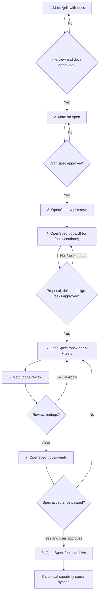

# Spec Fusion manual workflow

Every box is a separate action you explicitly request. Review the result before proceeding. The `spec-fusion` skill does not invoke any of these commands for you.

## Evidence and checkpoints

| Stage | Verify before moving on | Artifacts |
|---|---|---|
| 1. Interview | Scope, assumptions, edge cases, domain names, decisions | Conversation, `GLOSSARY.md`, ADRs |
| 2. Draft spec | User-approved requirements, acceptance criteria, non-goals; publishing destination approved | `/to-spec` output document or issue |
| 3. New change | Change name and related capabilities correct | `openspec/changes/<name>/` |
| 4. Plan | Deltas consistent with existing specs; tasks and design reviewed | `proposal.md`, `design.md`, `tasks.md`, `specs/**/spec.md` |
| 5. Apply | Tasks completed, tests pass, implementation understood | Git diff, test evidence, task checkboxes |
| 6. Code review | Standards and spec issues prioritized; fixes requested explicitly | Review findings |
| 7. Verify | Completeness, correctness, coherence against OpenSpec artifacts | Verification findings |
| 8. Archive | User approval, deltas synced, final behavior represented | `openspec/specs/` and archived change |

### Variations

- Use `/opsx:continue` instead of `/opsx:ff` if you want to review one planning artifact at a time.
- Use `/opsx:update` to revise existing planning artifacts coherently.
- If only the default OpenSpec profile is installed, `/opsx:propose` combines stages 3-4. Enable expanded for standalone `/opsx:verify`.
- **Codex spells OpenSpec skills differently:** `$openspec-new-change`, `$openspec-ff-change`, `$openspec-apply-change`, `$openspec-verify-change`, `$openspec-archive-change`.
- Matt Pocock's published interview name is **`grill-with-docs`** (with `docs`, plural).
- Git commits at checkpoints make it easier to stop and switch between Codex, Gemini CLI, and Claude Code.
